# Демо гарантий: сценарий и материалы

Документ для показа Guarantee Engine лидерам сообществ и партнёрам. Внутри — подготовка, пошаговый сценарий со скриншотами, тексты для Telegram и запасные варианты.

Скриншоты сняты с демо-аккаунтов на тестовом стенде, не с реальных пользователей. Реальные имена, почты и телефоны в кадр не попадают. Интерфейс — на русском.

## Что показываем

Три идеи, которые должны остаться у зрителя:

1. Платформа не хранит деньги: депозит лежит у поручителя, а система фиксирует подтверждения.
2. В сделке участвуют два бенефициара, и за каждого ручаются свои поручители.
3. Один депозит нельзя использовать дважды: покрытие блокируется под конкретную сделку и только частично.

## Формат

- **Короткий, 5 минут** — заявка, подтверждение, сделка, выплата.
- **Полный, 10–12 минут** — плюс две группы поручителей, лимиты и частичная блокировка.

Ниже полный сценарий; для короткого варианта убираются шаги 6 и часть объяснений.

## Подготовка

### Аккаунты

| Роль | Имя в демо | Что настроено |
|---|---|---|
| Бенефициар 1 (создатель сделки) | Мария Депозитор | счёт не нужен, Telegram привязан |
| Поручитель Марии | Иван Поручитель | счёт, профиль POINT / Cash, залог 200 |
| Поручитель Марии | Анна Поручитель | счёт, профиль POINT / Cash, залог 200 |
| Бенефициар 2 (получатель) | Олег Бенефициар | счёт не нужен, Telegram привязан |
| Поручитель Олега | Павел Поручитель | счёт, профиль POINT / Cash, залог 200 |
| Поручитель Олега | Ольга Поручитель | счёт, профиль POINT / Cash, залог 200 |
| Оператор | Ольга Оператор | владелец Platform, видит очередь рекламаций |

### Настройки

Настройки гарантий живут в `/community/platform/settings`, секция «Гарантии»:

- режим `pilot`;
- лимит тестовых единиц `1000`;
- поручителей в заявке `2`;
- депозиторов на поручителя `5`;
- группа операторов «Гарантии».

У всех поручителей есть залог: без него нельзя принять передачу.

### Telegram

- у всех участников привязан Telegram и включён `notify_telegram`;
- проверьте доставку за день до показа: одно тестовое уведомление;
- если Telegram недоступен — показывайте колокольчик в приложении и скриншоты ниже.

### Окна

- четыре окна браузера: Мария, Иван, Олег и оператор;
- Telegram на втором экране.

## Сценарий

### 1. Исходная точка

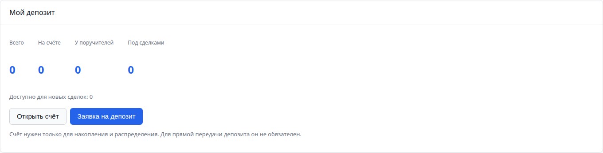

Говорим: у Марии нет счёта, и это нормально. Деньги пойдут напрямую поручителям. «Всего», «На счёте», «У поручителей» и «Под сделками» — это четыре разных ответа на вопрос «где мои деньги».

### 2. Заявка на депозит

Мария: **«Заявка на депозит»** → 60 POINT. Система делит сумму на два равных шага по 30.

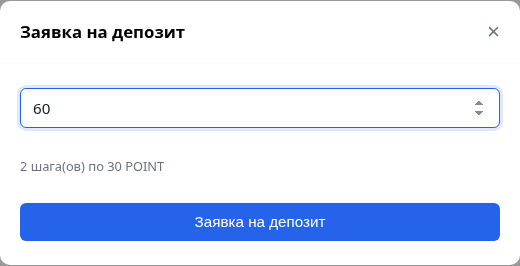

На каждом шаге выбирается поручитель. Пикер показывает только тех, кто принимает нужную валюту, имеет свободную ёмкость и не исчерпал лимит депозиторов.

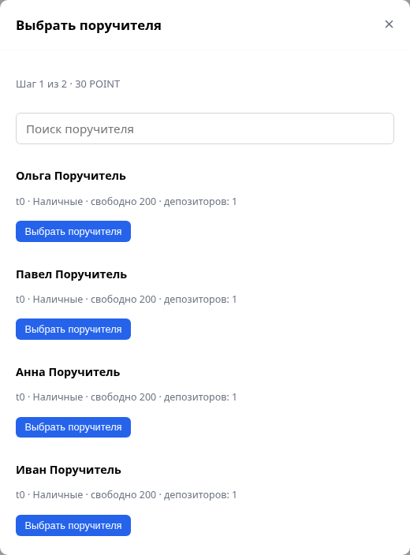

После выбора обоих шагов заявка выглядит так:

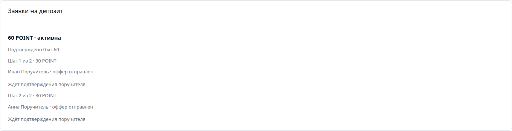

Говорим: это не «одна кнопка на всех», а заявка, которая живёт во времени. Каждый шаг можно пройти отдельно, а прогресс виден в карточке: «Подтверждено 0 из 60».

### 3. Подтверждение получения

У Ивана появляется оффер:


Иван и Анна принимают офферы, Мария отмечает отправку, поручители подтверждают получение. То же самое делают Павел и Ольга для Олега — у второго бенефициара своя заявка и своя группа поручителей.

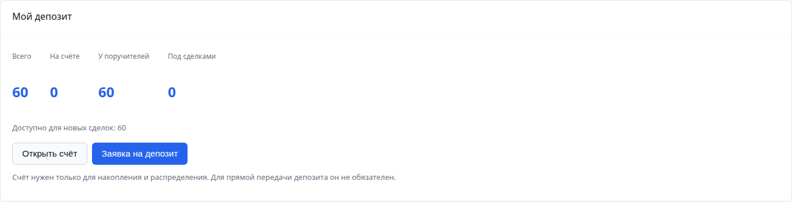

Говорим: подтверждение получателя — и есть бухгалтерская запись. Пока поручитель не подтвердил, деньги не входят в покрытие.

### 3.1. Мои поручители

После подтверждения Мария видит список своих поручителей: кто сколько хранит и в каком статусе.

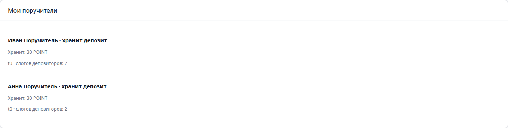

Говорим: это вычисляемый список, а не ручные закладки. Поручитель с активным депозитом не может уйти на паузу: сначала возврат или расторжение. Расторжение оформляется через возврат — одна сторона запрашивает, вторая подтверждает получение средств.

### 4. Сделка между бенефициарами

Мария создаёт сделку на 30 POINT с Олегом. В окне сразу видно её покрытие и поручителей.

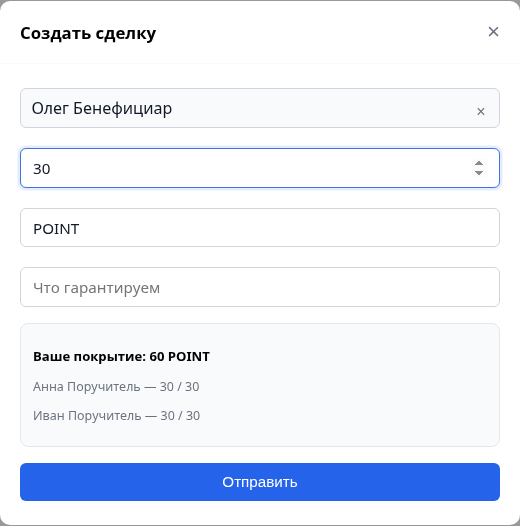

Олег открывает сделку и перед принятием видит **обе стороны**: кто создатель, кто бенефициар, какое у каждого покрытие и кто за кого ручается.

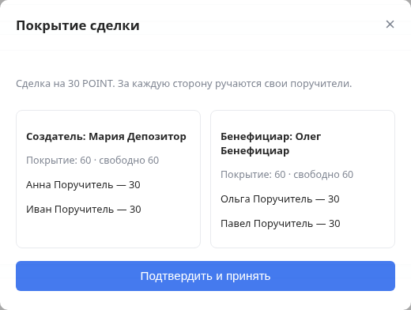

Говорим: это и есть ответ на вопрос «кому я доверяю». Не абстрактный рейтинг, а конкретные люди и суммы.

### 5. Блокировка и возврат

Олег принимает — покрытие блокируется у обоих: 30 у Марии и 30 у Олега.

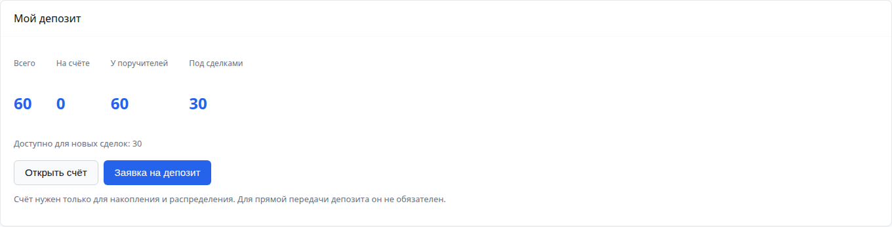

Говорим: блокируется ровно сумма сделки, а не вся передача. Вторая передача на 30 остаётся свободной. Если Олег не выполнит условия, его покрытие уйдёт Марии — для этого у него тоже есть поручители.

Возврат заблокированной части недоступен:

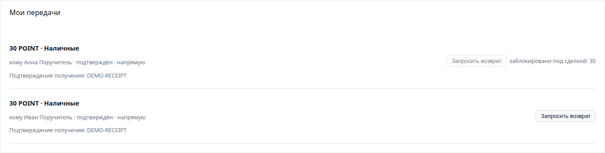

### 6. Спор

Мария открывает рекламацию. В демо её видит оператор — потому что текущий код пока операторский.

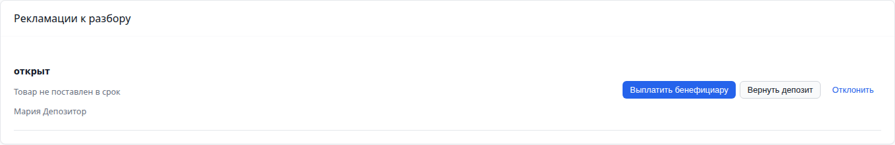

Настройки гарантий — в настройках Platform, секция «Гарантии» (только владелец/админ):

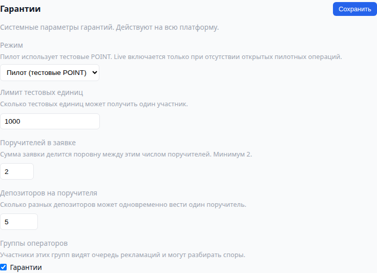

Говорим: в демо оператор выбирает решение, потому что автоматического голосования в коде ещё нет. В пилоте спор решает первая линия поручителей: 72 часа, большинство, при равенстве — deadlock.

### 7. Выплата

В демо оператор выбирает **«Выплатить бенефициару»** или **«Выплатить создателю»**. В пилоте этот исход определяет первая линия поручителей, а поручитель виновной стороны подтверждает выплату.


Говорим: выплата уменьшает передачу, а не закрывает её целиком. «Под сделками» снова 0, у поручителя остаётся 30.

## Что говорить

- Платформа не кастодиан: у бенефициара нет счёта, деньги у поручителя.
- В сделке две стороны, и у каждой — свои поручители; до принятия видно, кто за кого ручается.
- Покрытие блокируется с обеих сторон: обязательство есть у каждого.
- Заявка делится на равные шаги; число шагов задаётся в настройках Platform.
- Поручитель не может уйти на паузу, пока у него есть депозит: сначала возврат или расторжение.
- Оператор не подтверждает каждый депозит — только проверку поручителей в live и настройки.
- В пилоте спор решают поручители первой линии: 72 часа, большинство, при равенстве — deadlock. В демо оператор выбирает решение, потому что код пока операторский.
- Пилот: POINT, лимит 1000 на пользователя, конвертации нет.
- Telegram-first: события приходят сообщением со ссылкой на `/guarantee`.

## Telegram-сообщения

Примеры текстов, которые уходят при событиях (ссылка добавляется автоматически):

```
Новый оффер депозита
30 POINT на хранение, способ: Наличные
https://app.tribe.partnr.icu/guarantee
```

```
Оффер принят
Поручитель принял 30 POINT. Можно отправлять.
```

```
Получение подтверждено
30 POINT под гарантией поручителя
```

```
Новая сделка под гарантию
30 POINT: поставка до пятницы
```

```
Нужно подтвердить выплату
30 POINT по сделке 01M5...
```

Скриншот реального Telegram-сообщения добавляется после проверки на привязанном демо-аккаунте: в тестовом стенде бот не отправляет реальные сообщения.

## Если что-то пошло не так

| Ситуация | Что делаем |
|---|---|
| Telegram не пришёл | показываем колокольчик и скриншот сообщения |
| Поручитель не подтверждает | это часть истории: «пока не подтвердил — покрытия нет» |
| Сумма не делится на число шагов | показываем правило: «1001 не делится на 2» |
| Нет поручителя под шаг | объясняем: нужна свободная ёмкость не меньше шага |
| У поручителя кончились слоты депозиторов | показываем причину в пикере |
| Сделка не создаётся | проверяем подтверждённое покрытие: кнопка заблокирована с причиной |
| Оператор не видит рекламацию | проверяем, что он владелец/админ Platform и открыл `/guarantee` |

## Чек-лист за 10 минут

- [ ] режим `pilot`, лимит 1000, поручителей в заявке 2, депозиторов 5;
- [ ] у четырёх поручителей есть залог и профили POINT / Cash;
- [ ] у Марии и Олега созданы заявки и все шаги подтверждены;
- [ ] у всех привязан Telegram, `notify_telegram` включён;
- [ ] открыты четыре окна: Мария, Иван, Олег, оператор;
- [ ] проверено одно тестовое уведомление;
- [ ] скриншоты из этого документа открыты как резерв;
- [ ] на проде нет открытых передач и сделок от прошлых прогонов.

## Ограничения, о которых честно говорим

- в пилоте тестовые единицы поручителям выдаёт оператор;
- число шагов фиксировано настройкой, сумма должна делиться на него;
- поручитель выбирается только под полный шаг; подгонки шага под ёмкость пока нет;
- шаги и покрытие сторон равные; веса поручителей по уровню доверия появятся позже;
- расторжение пока идёт через возврат депозита, отдельной страницы договорённости нет;
- залог поручителя при выплате освобождается, а не списывается — решение ещё открыто;
- live-режим в USDT не прогнан на реальном сообществе;
- автоматического голосования поручителей в коде нет: в пилоте первую линию ведём вручную.

## Как обновить скриншоты

Скриншоты генерируются тестом, а не собираются руками:

```bash
make demo-shots
```

Тест поднимает e2e-стенд, создаёт двух бенефициаров и четырёх поручителей, проходит сценарий и сохраняет PNG в `tribe-docs/docs/assets/guarantee-demo/`. Файл: `apps/tribe-front/tests/e2e/demo-shots.spec.ts`. Без переменной `DEMO_SHOTS=1` тест пропускается. Локаль демо-аккаунтов — русская, чтобы скриншоты совпадали с языком документа.

Связанные документы: [Guarantee Engine](../modules/guarantee.md), [Пилот сети гарантий](guarantee-network-pilot.md).
