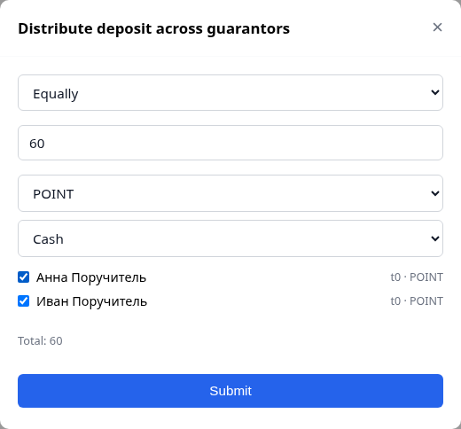
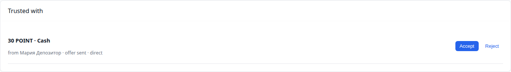
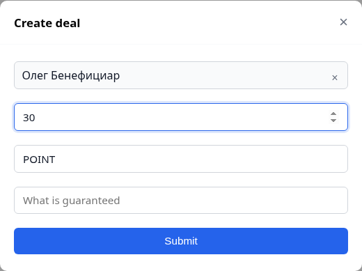
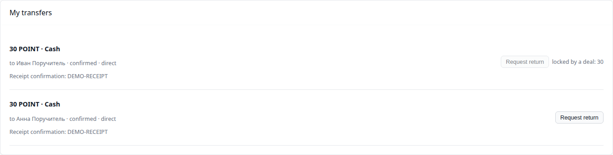
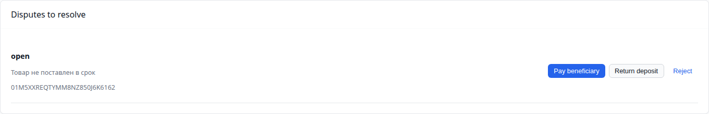
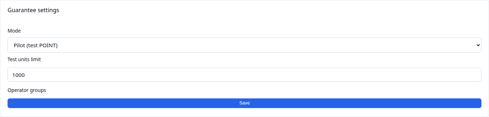
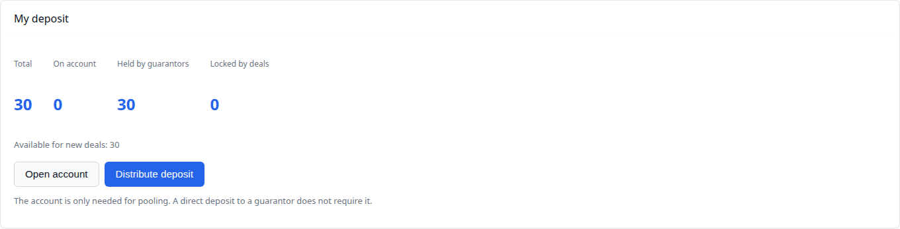

# Демо гарантий: сценарий и материалы

Документ для показа Guarantee Engine лидерам сообществ и партнёрам. Внутри — подготовка, пошаговый сценарий со скриншотами, тексты для Telegram и запасные варианты.

Скриншоты сняты с демо-аккаунтов на тестовом стенде, не с реальных пользователей. Реальные имена, почты и телефоны в кадр не попадают.

## Что показываем

Три идеи, которые должны остаться у зрителя:

1. Платформа не хранит деньги: депозит лежит у поручителя, а система фиксирует подтверждения.
2. Оператор не нужен на каждом шаге: он появляется только в споре и при настройках пилота.
3. Один депозит нельзя использовать дважды: покрытие блокируется под конкретную сделку и только частично.

## Формат

- **Короткий, 5 минут** — распределение, подтверждение, сделка, выплата.
- **Полный, 10–12 минут** — плюс лимиты уровней, частичная блокировка, возврат депозитора.

Ниже полный сценарий; для короткого варианта убираются шаги 6 и часть объяснений.

## Подготовка

### Аккаунты

| Роль | Имя в демо | Что настроено |
|---|---|---|
| Депозитор | Мария Депозитор | счёт не нужен, Telegram привязан |
| Поручитель 1 | Иван Поручитель | счёт, профиль: POINT / Cash, залог 200 |
| Поручитель 2 | Анна Поручитель | счёт, профиль: POINT / Cash, залог 200 |
| Бенефициар | Олег Бенефициар | счёт не нужен |
| Оператор | Ольга Оператор | владелец Platform, видит очередь рекламаций |

### Настройки

- `guarantee.mode = pilot`;
- `guarantee.test_limit = 1000`;
- `guarantee.operator_group_ids` — группа «Гарантии»;
- у поручителей есть залог: без него нельзя принять передачу.

### Telegram

- у всех участников привязан Telegram и включён `notify_telegram`;
- проверьте доставку за день до показа: одно тестовое уведомление;
- если Telegram недоступен — показывайте колокольчик в приложении и скриншоты ниже.

### Окна

- два окна браузера рядом: депозитор и поручитель;
- отдельная вкладка оператора;
- Telegram на втором экране.

## Сценарий

### 1. Исходная точка


Говорим: у депозитора нет счёта, и это нормально. Деньги пойдут напрямую поручителям. «Всего», «На счёте», «У поручителей» и «Под сделками» — это четыре разных ответа на вопрос «где мои деньги».

### 2. Распределение депозита

Депозитор: **«Распределить депозит»** → 60 POINT → **«Поровну»** → Иван и Анна → отправить.



Говорим: одна операция создаёт две прямые передачи. Оператор не участвует, платформа денег не касается.

У каждого поручителя появляется оффер:



### 3. Подтверждение получения

Иван и Анна принимают оффер, депозитор отмечает отправку, поручители подтверждают получение.


Говорим: подтверждение получателя — и есть бухгалтерская запись. Пока поручитель не подтвердил, деньги не входят в покрытие.

### 4. Сделка и блокировка

Депозитор создаёт сделку на 30 POINT с бенефициаром.



Бенефициар принимает — покрытие блокируется.


Говорим: блокируется ровно сумма сделки, а не вся передача. Вторая передача на 30 остаётся свободной.

Возврат заблокированной части недоступен:



### 5. Спор

Депозитор открывает рекламацию. Оператор видит её в отдельной очереди и выбирает решение.



Настройки пилота — режим, лимит, операторские группы (только владелец/админ Platform):



Говорим: оператор появляется только здесь. В обычных передачах его нет.

### 6. Выплата

Оператор выбирает **«Pay beneficiary»**, поручитель подтверждает выплату.



Говорим: выплата уменьшает передачу, а не закрывает её целиком. «Под сделками» снова 0, у поручителя остаётся 30.

## Что говорить

- Платформа не кастодиан: у депозитора нет счёта, деньги у поручителя.
- Оператор не подтверждает каждый депозит — только споры, проверку поручителей в live и настройки.
- Залог поручителя — его собственный резерв; он ограничивает, сколько гарантий можно выдать.
- Пилот: POINT, лимит 1000 на пользователя, конвертации нет.
- Telegram-first: события приходят сообщением со ссылкой на `/guarantee`.

## Telegram-сообщения

Примеры текстов, которые уходят при событиях (ссылка добавляется автоматически):

```
Новый оффер депозита
30 POINT на хранение, способ: Cash
https://app.tribe.partnr.icu/guarantee
```

```
Оффер принят
Поручитель принял 30 POINT. Можно отправлять.
```

```
Получение подтверждено
30 POINT под гарантией поручителя
```

```
Нужно подтвердить выплату
30 POINT по сделке 01M5...
```

Скриншот реального Telegram-сообщения добавляется после проверки на привязанном демо-аккаунте: в тестовом стенде бот не отправляет реальные сообщения.

## Если что-то пошло не так

| Ситуация | Что делаем |
|---|---|
| Telegram не пришёл | показываем колокольчик и скриншот сообщения |
| Поручитель не подтверждает | это часть истории: «пока не подтвердил — покрытия нет» |
| Сделка не принимается | проверяем свободное покрытие и лимит уровня |
| Оператор не видит рекламацию | проверяем, что он владелец/админ Platform и открыл `/guarantee` |
| Сумма больше лимита | используем 30–60 POINT, это ниже T0/T1 |

## Чек-лист за 10 минут

- [ ] режим `pilot`, лимит 1000;
- [ ] у поручителей есть залог и профили POINT / Cash;
- [ ] депозитор и бенефициар без счёта — так и задумано;
- [ ] у всех привязан Telegram, `notify_telegram` включён;
- [ ] открыты три окна: депозитор, поручитель, оператор;
- [ ] проверено одно тестовое уведомление;
- [ ] скриншоты из этого документа открыты как резерв;
- [ ] на проде нет открытых передач и сделок от прошлых прогонов.

## Ограничения, о которых честно говорим

- в пилоте тестовые единицы поручителям выдаёт оператор;
- залог поручителя при выплате освобождается, а не списывается — решение ещё открыто;
- live-режим в USDT не прогнан на реальном сообществе;
- переход в live блокируется, пока есть открытые пилотные операции.

## Как обновить скриншоты

Скриншоты генерируются тестом, а не собираются руками:

```bash
make demo-shots
```

Тест поднимает e2e-стенд, создаёт демо-аккаунты, проходит сценарий и сохраняет PNG в `tribe-docs/docs/assets/guarantee-demo/`. Файл: `apps/tribe-front/tests/e2e/demo-shots.spec.ts`. Без переменной `DEMO_SHOTS=1` тест пропускается.

Связанные документы: [Guarantee Engine](../modules/guarantee.md), [Пилот сети гарантий](guarantee-network-pilot.md).
