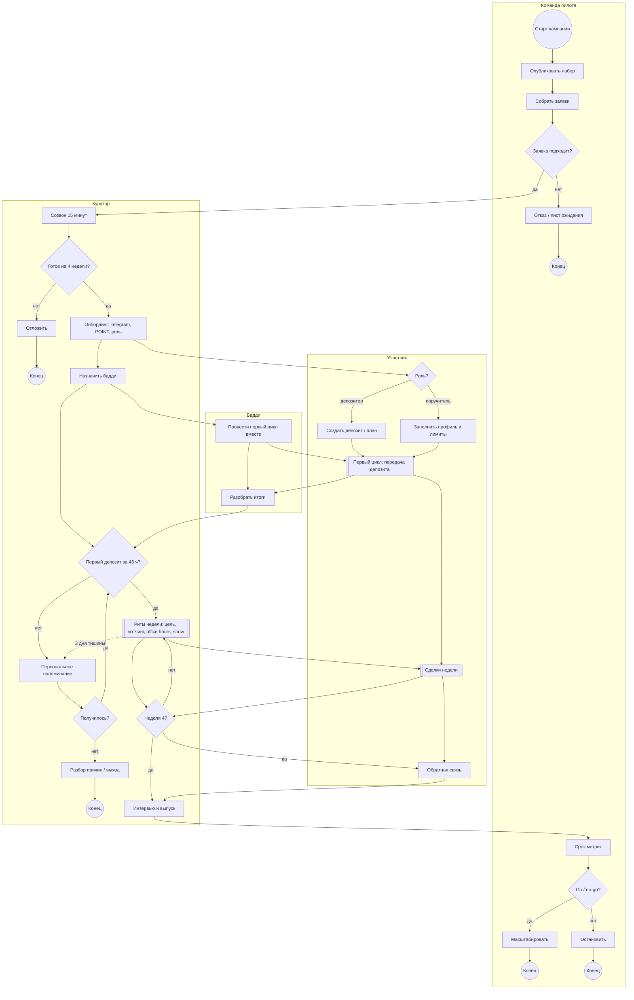
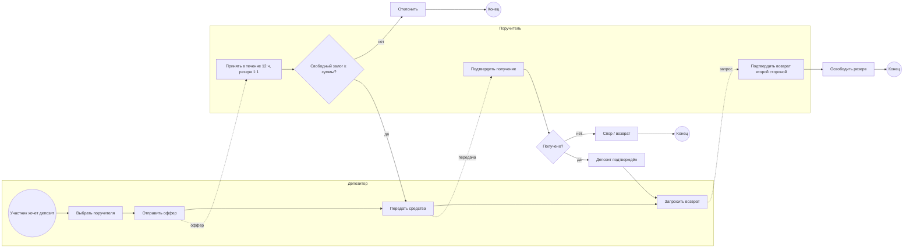
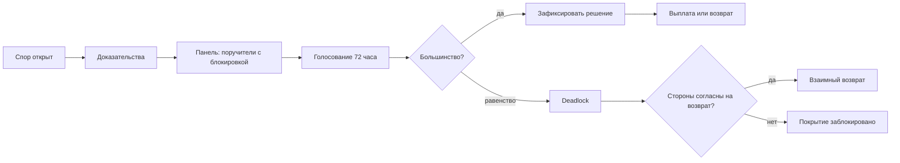

# Пилотная кампания: BPMN-схемы

Кампания пилота: набор, онбординг, первая передача депозита, первая сделка, удержание и выпуск.

Строгие BPMN 2.0 с DI для bpmn.io:

- [pilot-campaign.bpmn](../assets/bpmn/pilot-campaign.bpmn) — путь участника и роли.
- [deposit-custody.bpmn](../assets/bpmn/deposit-custody.bpmn) — передача депозита поручителю.
- [dispute-resolution.bpmn](../assets/bpmn/dispute-resolution.bpmn) — спор первой линии.

## 1. Путь участника

## 2. Передача депозита

Это не сделка, а custody: депозитор передаёт средства поручителю, поручитель принимает их на хранение и резервирует 1:1.

## 3. Сделка

Сделка — обязательство между создателем и бенефициаром. Поручитель не сторона сделки: он только гарантирует покрытие.

- создатель предлагает сделку;
- бенефициар принимает;
- покрытие блокируется с обеих сторон;
- после завершения блокировка снимается;
- при споре решает первая линия поручителей.

Для первого цикла в пилоте достаточно небольшой сделки на 60 POINT между двумя участниками. Передача депозита — это подготовка, а не сама сделка.

## 4. Спор первой линии

Первая линия — поручители, чьё покрытие заблокировано в этой сделке. Глубже не эскалируем.

Правила:

- один поручитель — один голос;
- простое большинство;
- срок — 72 часа;
- один раунд, без автоматического переголосования;
- при равенстве — deadlock;
- оператор не решает и не перебивает первую линию.

При deadlock:

- покрытие остаётся заблокированным;
- принудительной выплаты нет;
- стороны могут только взаимно подтвердить возврат;
- если стороны не договорились, спор остаётся открытым.

### Ручной протокол для пилота

Пока код не меняем, первую линию ведём вручную:

1. Спор открывается в ветке сделки.
2. Куратор фиксирует состав панели: поручители с заблокированным покрытием.
3. Стороны присылают доказательства.
4. Каждый поручитель пишет исход и причину: `pay_beneficiary`, `pay_creator`, `return_both`.
5. Через 72 часа куратор считает голоса.
6. При большинстве — фиксирует решение и исполняет.
7. При равенстве — deadlock, покрытие остаётся заблокированным.

Важно: текущая реализация в коде пока операторская. В пилоте куратор (он же оператор) только фиксирует ручной протокол, а не принимает решение. Автоматическое голосование поручителей — после пилота, если модель подтвердится.

## 5. Ключевые шлюзы

- **Заявка подходит** — фильтр от любопытствующих.
- **Готов на 4 недели** — commitment before onboarding.
- **Первый депозит за 48 ч** — главный показатель активации гарантии.
- **Получилось после напоминания** — ранний выход вместо тихого отвала.
- **Неделя 4** — конец основного цикла и переход к выпуску.
- **Go / no-go** — решение по метрикам.
- **Большинство / deadlock** — правило спора первой линии.

## 6. Обозначения

- `(( ))` — событие начала или конца.
- `[ ]` — задача.
- `[[ ]]` — подпроцесс.
- `{ }` — шлюз.
- Пунктир — передача сообщения между ролями.
